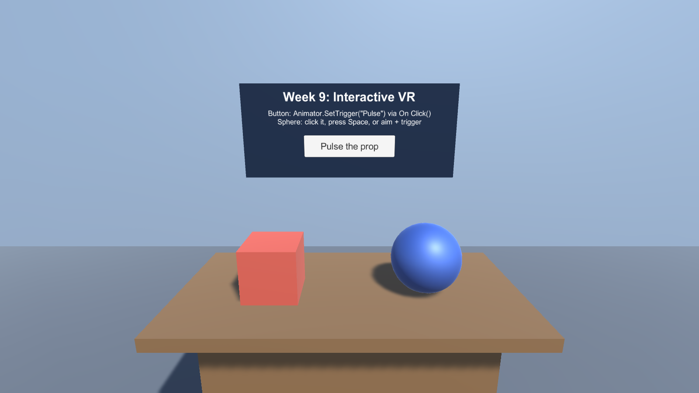
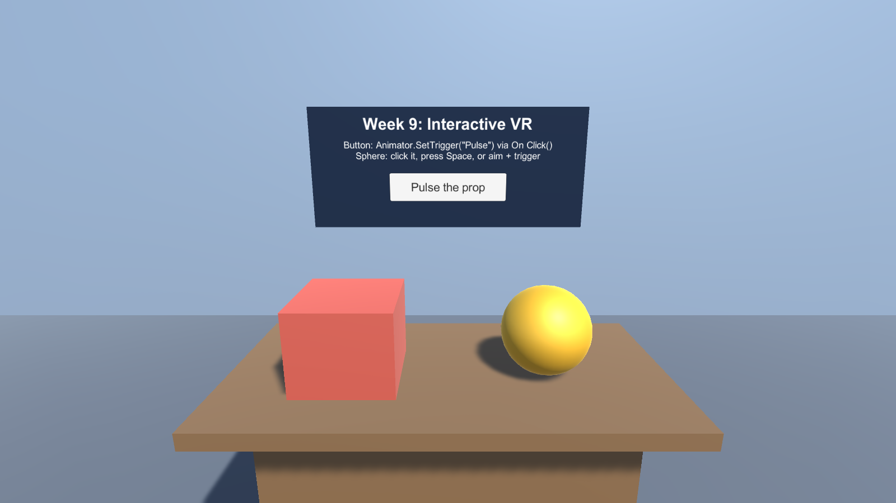
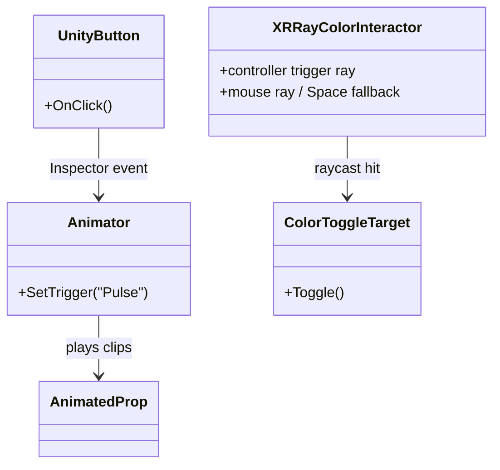

# Week 9 — Interactive VR: Animation, Buttons, and C#

**Chapter 5 lab.** Build two small interactions in a fresh Unity 2022.3.62f3 project: a UI button that triggers an animation without a gameplay script, and a controller ray that changes a target using C#.

## Requirements

- Unity **2022.3.62f3** and a 3D project.
- **Unity UI (UGUI)** for the Button and Canvas. Install `com.unity.ugui` from Package Manager if it is not already present.
- No XR Interaction Toolkit or SteamVR dependency is needed to compile these scripts.
- To use a headset, install and enable an XR provider supported by your headset (for example, XR Plug-in Management + OpenXR). The C# ray reads Unity's built-in `UnityEngine.XR` device features. For clicking the UGUI button with an XR controller, additionally install XR Interaction Toolkit and configure its XR UI input module and ray interactor; the button works with a mouse without that optional setup.
- The keyboard/mouse fallback uses Unity's built-in Input Manager APIs. Set **Active Input Handling** to **Input Manager (Old)** or **Both** in Project Settings → Player → Other Settings.

Copy this folder's `Assets/Scripts` into the `Assets/` directory of your Unity project. No imported models, textures, or audio are used.

## Ready-made project

This folder is also a Unity 2022.3.62f3 project with the finished scene. Open the folder in Unity Hub, then open `Assets/Scenes/InteractiveVR.unity` and press Play. Active Input Handling is already set to **Input Manager (Old)**. The scene was generated by **Week 9 → Build Interactive VR Scene** ([`Assets/Editor/BuildInteractiveVRScene.cs`](Assets/Editor/BuildInteractiveVRScene.cs)); run it again to rebuild the scene, materials, clips, and Animator Controller. For the lab itself, build your own scene with the steps below and use this one to compare.

## Build the test scene

1. Create a floor, a few cubes as a table or walls, and a **Sphere** named `Color Target` in front of the starting camera. Keep its collider enabled.
2. Add `ColorToggleTarget` to the sphere. Assign its Renderer if Unity does not fill the field automatically. Choose an active color in the Inspector.
3. Add `XRRayColorInteractor` to an always-active object, such as the XR Origin. Assign the XR Origin's **Camera Offset / tracking-space transform** to `Tracking Space`; this transform converts controller poses into world space. Assign the Main Camera and the `Color Target` component to the fallback fields. Leave the interaction layer mask on its default value unless your target uses a dedicated layer.
4. For the animation interaction, create a cube named `Animated Prop`. Use the Animation window to create an `Idle` clip and a short `Pulse` clip. Key the prop's local scale in `Pulse`: start at its normal size, grow briefly, then return to normal. Turn **Loop Time** off for `Pulse`.
5. Open the Animator window for `Animated Prop`. Make `Idle` the default state, add a **Trigger** parameter named `Pulse`, and create an `Idle → Pulse` transition conditioned on that trigger. Add a `Pulse → Idle` transition with **Has Exit Time** enabled.
6. Create a UI Button (GameObject → UI → Button). Unity creates a Canvas and EventSystem if needed. In the Button's **On Click()** list, add `Animated Prop`, choose **Animator → SetTrigger (string)**, and enter `Pulse`.
7. Press Play and try both interactions. Save the scene in your own project if you want to keep it. If something behaves differently, compare it with the ready-made `InteractiveVR` scene.

### Using the button in VR

For a headset-clickable button, set the Canvas to **World Space**, position it within reach, and use the XR Interaction Toolkit's tracked-device UI input module and XR ray interactor. Enable **Is Trigger** on the ray interactor and ensure the Canvas has a `Tracked Device Graphic Raycaster`. Without that optional package setup, test the same button with the mouse in the Game view.

## Controls and expected results

| Test | Input | Expected result |
| --- | --- | --- |
| Animated button | Click the UI Button (or point/click it with the optional XR UI setup) | `Animated Prop` plays its one-shot scale pulse and returns to `Idle`. No custom gameplay script is attached to the button. |
| XR ray interaction | Aim the right controller at `Color Target` and press its trigger | The target changes between its original material color and the configured active color. A hit is logged in the Console. |
| 2D ray fallback | Click the target in the Game view | The camera ray toggles the same target. |
| 2D keyboard fallback | Press **Space** | The assigned fallback target toggles even without a camera ray hit. |

If the XR ray does not respond, confirm the XR provider is active, the controller reports a trigger-button feature, the target has a collider, and `Tracking Space` is assigned. The mouse and Space tests isolate the target script from headset setup.

## Screenshots

Captured from a Windows build of `InteractiveVR.unity` (Unity 2022.3.62f3, no headset).

*Before any input.*

*A camera ray through the sphere toggled it to its active color (C#). The button's On Click() called `Animator.SetTrigger("Pulse")`, and the prop is captured mid-pulse (Inspector event). The prop returned to Idle scale afterwards, and Space toggled the sphere back.*

## Interaction diagram

## Turn in

- A screenshot or short clip showing both interactions.
- A simple diagram of each event path (you can adapt the diagram above).
- One sentence explaining which part used an Inspector event and which part used C#.
