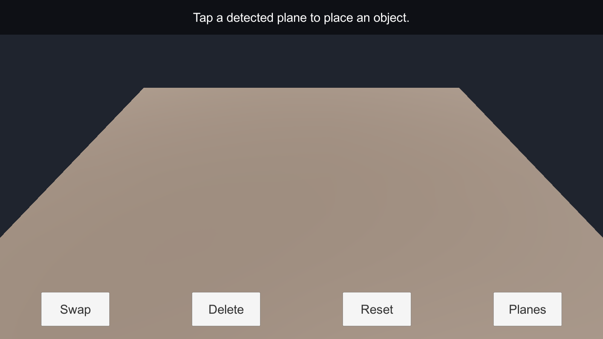
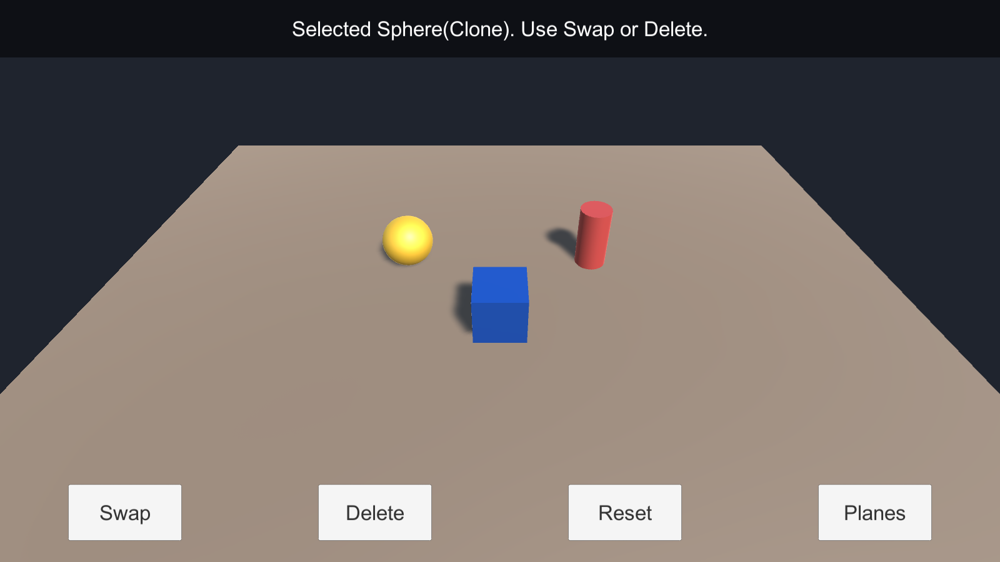
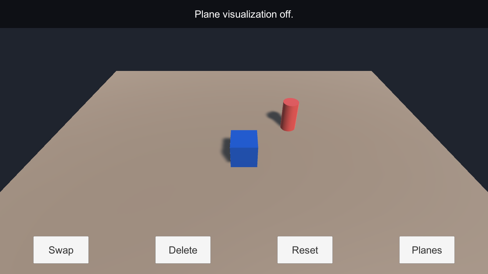

# Week 10 — Interactive AR: place, select, and swap

> **Chapter:** 6, interactive augmented reality using touch controls and C# UI.
> **Unity:** 2022.3.62f3. This is a source-first lab: create the scene and primitive prefabs in the Editor; no opaque asset downloads are needed.

## Lab goal

Build a small AR tabletop where a tap places a primitive on a detected surface. Tap a placed object to select it, then use screen UI to swap its variant, delete it, clear the scene, or show/hide detected planes. The same scripts have a mouse-and-ground-plane fallback for Editor testing.

## 1. Open the project

1. Open this folder in Unity Hub using **2022.3.62f3**. Let Package Manager resolve the manifest.
2. The manifest pins **AR Foundation 5.1.5**, **ARCore XR Plugin 5.1.5**, **ARKit XR Plugin 5.1.5**, **XR Plug-in Management 4.4.0**, and **Unity UI 1.0.0**. AR Foundation 5.1.5 is the Unity 2022.3-compatible package line used here. The Google ARCore and Apple ARKit plugins are provider packages; enable only the provider for your build target.
3. In **Edit → Project Settings → XR Plug-in Management**, install/enable the Android provider for Android or the iOS provider for iOS. Enable **ARCore** under Android or **ARKit** under iOS. Resolve any Project Validation items shown for that platform.

If you are adding this lab to an existing Unity project instead, install the same package versions through Package Manager and copy `Assets/Scripts` into that project's `Assets` folder.

The manifest also lists the built-in modules the scripts need (Physics, UI, XR, and so on). **Active Input Handling** is set to **Both**: AR Foundation's camera `TrackedPoseDriver` uses the Input System, and `ARPlacementController` reads touches and the mouse through the Input Manager.

### Ready-made scenes

The project already contains the finished result of section 2, generated by **Week 10 → Build Interactive AR Scenes** ([`Assets/Editor/BuildInteractiveARScenes.cs`](Assets/Editor/BuildInteractiveARScenes.cs)):

| Scene | Use |
| --- | --- |
| `Assets/Scenes/InteractiveAR.unity` | Device build: AR Session, XR Origin (Mobile AR) with AR Plane Manager (`Assets/Prefabs/AR Plane.prefab`) and AR Raycast Manager. |
| `Assets/Scenes/InteractiveAR_EditorFallback.unity` | Editor test from section 3: no AR managers, camera aimed at the Y 0 fallback plane over a visual-only tabletop. |

Both scenes use the `Cube`, `Sphere`, and `Cylinder` prefabs in `Assets/Prefabs`. Each prefab's root sits on the surface with the primitive lifted above it, so placed objects rest on the plane. Re-run the menu item to rebuild them. Provider setup in step 3 is still yours to do for your build target.

## 2. Build a scene from primitives

1. Create and save a scene named `InteractiveAR`.
2. Add an **AR Session** (`GameObject → XR → AR Session`). Add an **XR Origin (Mobile AR)** from the XR menu. Menu wording can vary slightly by package version; the required pieces are an `XROrigin` with an AR camera.
3. On the XR Origin, add **AR Plane Manager** and **AR Raycast Manager**. Assign a plane prefab to AR Plane Manager if you want visible plane boundaries. Keep the AR camera tagged `MainCamera`.
4. Create at least two variants from built-in primitives (for example, a cube and a sphere). Give each a useful name, scale it to a tabletop size (about 0.1–0.2 Unity units), and ensure it has a Collider. Drag each from the Hierarchy into `Assets/Prefabs` to create a prefab, then remove its scene instance.
5. Create an empty `PlacementController` object and attach `ARPlacementController`. Assign the XR Origin's AR Raycast Manager and AR Plane Manager, the AR camera, and your prefabs in the same order you want the Swap button to cycle through.
6. Create a Screen Space - Overlay Canvas with six uGUI Buttons named **Place**, **Previous**, **Swap**, **Delete**, **Reset**, and **Planes**, plus a uGUI Text for status. Assign them to the controller fields. Create an EventSystem if the Canvas did not add one. Button listeners are connected by the script; do not add duplicate On Click handlers.
7. Optional, as in the book's food menu: add a flat **Placement Reticle** (a thin cylinder with no collider) and a world-space **Details Label** canvas with a Text child, then assign them to `Placement Indicator` and `Details Label`. Fill each prefab's `ARPlaceable` **Details** (name and description).
8. Press Play on a phone/tablet build to scan and place. Aim the reticle at a detected surface and press **Place**, or tap a surface. The first prefab is the initial variant; Swap advances to the next variant and Previous goes back (both wrap around), replacing the selected object in place. Pinch with two fingers to scale the selected object (0.1×–10×); in the Editor, use the mouse scroll wheel.

### What the scripts do

| Script | Responsibility |
| --- | --- |
| `Assets/Scripts/ARPlacementController.cs` | Reads touch or editor mouse taps, selects objects by collider, raycasts detected AR planes, shows the placement reticle, places/swaps/deletes/resets objects, pinch-scales the selection, shows its details label, and wires up the UI buttons. |
| `Assets/Scripts/ARPlaceable.cs` | Marks a selectable object, gives the current selection a small scale highlight, clamps scaling to 0.1–10×, and holds a serializable `PlaceableDetails` (name, description), like the book's `Food` class. |

## 3. Editor and 2D fallback

You can test the interaction loop without an AR device:

1. Make a simple test scene camera, tag it `MainCamera`, and aim it toward the horizontal plane at the configured `Fallback Ground Height` (default `0`). For example, place the camera at `(0, 1.5, -4)` facing toward positive Z, with the ground at Y `0`.
2. Add the controller, primitive prefabs, Canvas, and EventSystem as above, but leave **AR Raycast Manager** and **AR Plane Manager** unassigned. The controller intersects mouse rays with the fallback ground plane and uses normal physics raycasts to select placed objects.
3. Press Play. Left-click the ground to place, click a placed object to select, and use the UI buttons. In this mode, the Planes button only changes the status message because there are no AR plane visuals.

When an AR Raycast Manager is assigned, a missed AR plane hit does **not** silently place an object on the fallback plane. Scan a surface until its plane is detected, then tap it.

`InteractiveAR_EditorFallback.unity` is already set up this way, with the camera at `(0, 1, -1.2)` tilted 40° down so tabletop-sized objects are easy to click.

### Screenshots (Editor fallback)

Captured from a Windows build of `InteractiveAR_EditorFallback.unity` (Unity 2022.3.62f3). Taps went through the controller's own tap handling; the buttons were pressed through their `onClick` listeners. The AR device scene was built and opened but not run on a phone or tablet.

*Start: status asks for a tap.*

*Three taps and three Swaps placed Cube → swapped to Sphere, placed Sphere → swapped to Cylinder, placed Cylinder → swapped to Cube. Tapping the sphere selected it (1.08× highlight); only one object is highlighted.*

*Delete removed only the selected sphere; Planes reports its state. Reset (not shown) cleared both objects and returned to the Cube variant.*

## 4. Device build and test

### Android / ARCore

1. Use an ARCore-supported Android device. In **File → Build Settings**, select Android and switch platform if needed.
2. In XR Plug-in Management, enable **ARCore** for Android. Check Player Settings for the required Android API level and camera permission; accept the camera prompt on first launch.
3. Connect the phone with USB debugging enabled, select it in **Run Device**, and Build and Run. Move the phone slowly until a plane appears, then tap to place.

### iOS / ARKit

1. Use an ARKit-capable iPhone or iPad. Switch the build target to iOS and enable **ARKit** in XR Plug-in Management.
2. Set a unique Bundle Identifier and a clear camera usage description in Player Settings. Build the Xcode project, open it in Xcode, select your signing team/device, then build and run.

### Interaction checks

- [ ] A detected plane becomes visible while scanning.
- [ ] Tapping the plane places the current primitive; the selected item gets a subtle size highlight.
- [ ] Tapping another placed item changes selection.
- [ ] Swap replaces the selected primitive at the same location; repeated presses cycle through all assigned variants.
- [ ] Place drops the current variant at the reticle; Previous cycles backward; a two-finger pinch (scroll wheel in the Editor) scales the selection; the details label floats above it.
- [ ] Delete removes only the selected item; Reset clears all placed items and returns to the first variant.
- [ ] Planes toggles plane visualization without stopping plane detection.
- [ ] The mouse fallback supports place, select, swap, delete, and reset in the Editor.

## Troubleshooting

| Symptom | Check |
| --- | --- |
| No detected surface | Confirm the correct provider is enabled for the active build target; use a supported device, grant camera access, and move slowly over a textured, well-lit surface. |
| Taps place nothing | Wait for a detected plane; verify the AR Raycast Manager is assigned and enabled. In fallback mode, verify the camera ray can reach the configured ground height. |
| Objects cannot be selected | Ensure each prefab has a Collider and an `ARPlaceable` is on its root or parent. Confirm the UI EventSystem is present. |
| UI buttons do nothing | Assign the Button fields and status Text on the controller. The buttons must be uGUI Buttons on a Canvas. |
| Compiler cannot find AR types | Let Package Manager finish resolving the pinned dependencies and check for package errors in the Console. |

## Deliverable

Add a screenshot from the device or Editor and answer:

- Which surface did you place on, and which prefab variants did you build?
- What changes in the selection highlight when you tap a different object?
- What did you test on-device versus in the Editor fallback?
- What interaction would you add next (for example, rotate, scale, or reposition)?