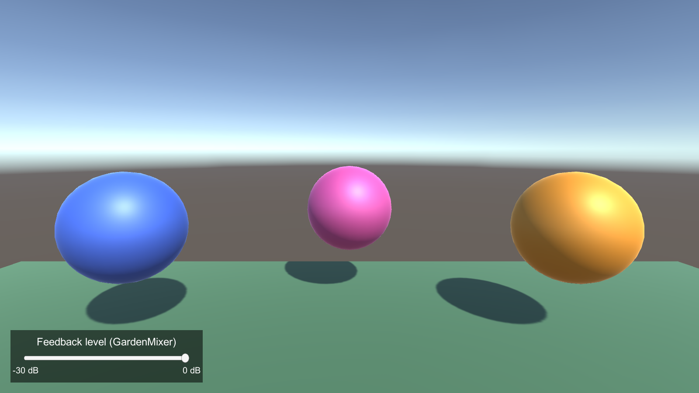
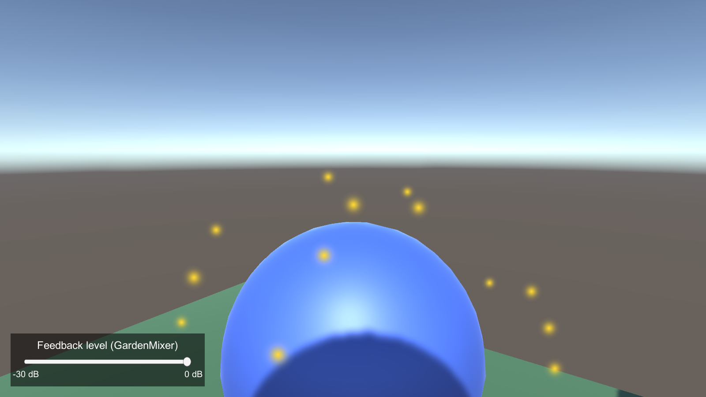
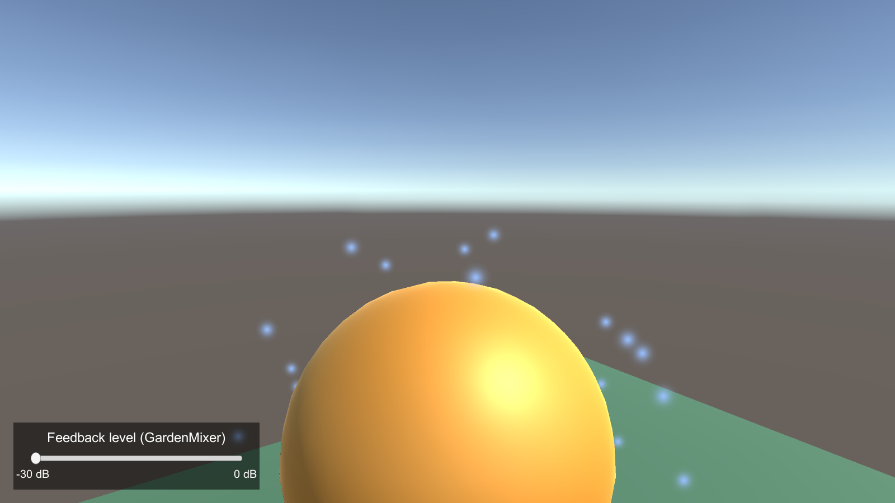

# Week 11 — Sound and VFX: Resonance Garden

**Book:** Chapter 7 — sound theory, AudioSources, AudioMixer, and ParticleSystem  
**Unity:** 2022.3.62f3  
**Exercise:** Build a small immersive garden of spatial sound beacons. Each beacon plays a different procedural tone and releases a particle burst when the player enters its space. Route the tones through an AudioMixer group and change their level with a UI Slider.

This is a source-first lab: the scene is assembled from Unity primitives and built-in components. The scripts generate their own audio; no external art, audio, packages, or headset SDK are required. Test in the Editor first, then use a headset rig if one is available.

## Ready-made project

This folder is also a Unity 2022.3.62f3 project with the finished result of sections 1–3. Open it in Unity Hub, then open `Assets/Scenes/ResonanceGarden.unity`; the mixer is `Assets/Audio/GardenMixer.mixer`. The scene and mixer were generated by **Week 11 → Build Resonance Garden** ([`Assets/Editor/BuildResonanceGarden.cs`](Assets/Editor/BuildResonanceGarden.cs)), which also writes `Assets/Audio/FountainLoop.wav`. The `Player` capsule's Capsule Collider is removed because its Character Controller already acts as its collider. Unity has no public API for creating mixers, so the builder uses Unity's internal mixer editor code; if a Unity upgrade breaks that, create the mixer by hand (section 3) and run the menu item again.

## Learning goals

- Relate frequency and harmonics to perceived pitch and timbre.
- Configure an AudioSource for positional (3D) playback and distance attenuation.
- Route audio through an AudioMixer group and control an exposed parameter.
- Trigger a ParticleSystem and sound together in response to a physical overlap.

## 1. Create the scene

1. Use a **3D (Built-In Render Pipeline)** project in Unity 2022.3.62f3. Create a scene named `ResonanceGarden` and save it under `Assets/Scenes/`.
2. Add a **Plane** named `GardenFloor` at `(0, 0, 0)`, with its default scale. Add a **Directional Light** if the scene does not already have one.
3. Add three primitive **Spheres** named `BeaconLow`, `BeaconMid`, and `BeaconHigh`. Put them at `(-2, 1, 3)`, `(0, 1, 4)`, and `(2, 1, 3)`. Give them distinct built-in materials or colors so they are easy to identify.
4. Create a player rig. For a quick desktop test, use a Capsule named `Player` at `(0, 1, 0)` with a **Character Controller** and a child Camera at `(0, 0.7, 0)`. Move the player with the Inspector during the first test. For VR, use the course headset rig and put the `Player` tag on its root; make sure its tracked camera is the scene's only enabled **Audio Listener**.
5. Add a **Sphere Collider** to each beacon, enable **Is Trigger**, and set its radius to `1.5`. Add a **Rigidbody** to each beacon; enable **Is Kinematic** and disable **Use Gravity**. This ensures Unity sends trigger callbacks without letting the beacon move.

## 2. Add the beacon feedback

Copy `Assets/Scripts/ResonanceBeacon.cs` and `Assets/Scripts/MixerLevelController.cs` from this folder into your project's `Assets/Scripts/`. Wait for Unity to compile, then configure each beacon:

| Inspector field | `BeaconLow` | `BeaconMid` | `BeaconHigh` |
| --- | ---: | ---: | ---: |
| `Frequency Hz` | `261.63` | `440` | `659.25` |
| `Tone Seconds` | `0.8` | `0.8` | `0.8` |
| `Retrigger Cooldown` | `0.6` | `0.6` | `0.6` |

On every beacon, add a **Particle System** as a child named `Burst`. Set **Play On Awake** off, **Looping** off, **Duration** `0.5`, **Start Lifetime** `0.6`, **Start Speed** `2`, **Start Size** `0.08`, **Emission / Rate over Time** `0`, and add one **Burst** at time `0` with count `35`. Use the Shape module's **Sphere** with radius `0.08`; choose a color that contrasts with the beacon. Drag the child ParticleSystem into the script's `Burst` field. The built-in particle material is sufficient in the Built-In Render Pipeline. If using URP, assign a compatible `Universal Render Pipeline/Particles/Unlit` material.

Add an **AudioSource** to each beacon and wire it to `Audio Source` on `ResonanceBeacon`. Set:

- **Play On Awake:** off; **Loop:** off; **Spatial Blend:** `1` (3D).
- **Volume:** `1`; **Pitch:** `1`; **Doppler Level:** `0`.
- **Volume Rolloff:** Logarithmic; **Min Distance:** `1`; **Max Distance:** `12`.
- **Output:** the `Feedback` group created in the next section.

The script synthesizes a short decaying tone at the configured frequency. Its second harmonic adds a little brightness; compare the three beacons and listen for how changing the fundamental changes pitch. No clip asset is needed.

## 3. Route and control the mix

1. In the Project window, choose **Create → Audio Mixer** and name it `GardenMixer`. Open it and create a child group of `Master` named `Feedback`.
2. On the `Feedback` group's **Attenuation** effect, expose the volume parameter and name it exactly `FeedbackLevelDb`. Leave it at `0 dB` initially.
3. Assign `GardenMixer` to each beacon AudioSource's **Output** field and select its `Feedback` group.
4. Create an empty object named `MixerControls`, add `MixerLevelController`, and assign `GardenMixer` to its `Mixer` field. Leave **Exposed Volume Parameter** as `FeedbackLevelDb`.
5. Add a UI **Canvas** and **Slider**. Set the Slider's minimum to `-30`, maximum to `0`, and value to `0`. In **On Value Changed (Single)**, add `MixerControls` and select `MixerLevelController.SetFeedbackLevel(float)`. Label the endpoints `-30 dB` and `0 dB` if you add text.

The slider changes only the `Feedback` group's exposed attenuation. It does not alter the AudioSource's spatial settings, so the distance cues remain available while you compare mixer levels.

## 4. Test and observe

1. Confirm there is exactly one enabled Audio Listener, on the player's camera. Press **Play** and move the player collider into `BeaconLow`.
2. Confirm a particle burst and low tone happen together. Walk out, wait for the cooldown, and enter again. Repeat with the middle and high beacons.
3. Stand near one beacon and move away. Listen for the sound to attenuate with distance; it should be strongest close to the source and quiet near its Max Distance.
4. Move the Slider from `0` to `-30 dB`. The beacon should become much quieter, without changing its pitch or particle effect. Return it to `0 dB`.
5. In VR, turn your head and move around a beacon. Its apparent direction and loudness should follow the AudioSource's world position and distance.

### Expected results

- Each beacon produces its assigned pitch: low, A4-ish middle, then higher E5-ish.
- Entering a beacon produces one sound and one burst; remaining inside does not repeatedly fire the effect.
- Sound is spatialized and attenuates with distance; the mixer slider changes the shared feedback level.
- The exercise works without imported audio or visual assets. Missing optional script references do not prevent the other feedback channel from working.

### If something does not work

| Symptom | Check |
| --- | --- |
| No feedback when entering | Player root is tagged `Player`; beacon Sphere Collider has **Is Trigger** checked; beacon has a kinematic Rigidbody; the player has a collider. |
| Particles appear but no tone | AudioSource is enabled, assigned in `Audio Source`, not muted, and the camera has an enabled Audio Listener. |
| Tone plays but does not sound positional | AudioSource **Spatial Blend** is `1`, and its **Output** is the Feedback mixer group. |
| Slider has no effect | The mixer's exposed parameter is spelled `FeedbackLevelDb`; the slider event targets `MixerControls.SetFeedbackLevel`; all three sources route to `Feedback`. |
| Burst is invisible | ParticleSystem is assigned, its Burst count is nonzero, and its material uses a shader supported by the project's render pipeline. |

### Screenshots

Captured from a Windows build of `ResonanceGarden.unity` (Unity 2022.3.62f3, desktop rig, no headset). The player was moved into each beacon with its Character Controller, so the trigger callbacks ran normally. In the same run, the Audio Listener heard about 270, 445, and 656 Hz from the three beacons (estimated from zero crossings), and BeaconHigh measured 32.5 dB quieter with the slider at -30 dB.

*Start: BeaconLow, BeaconMid, BeaconHigh.*

*Entering BeaconLow: one burst and one low tone. Staying inside did not retrigger.*

*Slider at -30 dB: the burst still plays and the tone keeps its pitch, but it is much quieter.*

## Fountain, impact speed, and particle polish (book Ch. 7)

The ready-made scene adds three book techniques on top of the beacons; they are optional in a hand-built scene.

- **Imported clip:** a `Fountain` cylinder loops `Assets/Audio/FountainLoop.wav` (3D, Linear rolloff 1–14 m, routed to `Master` so the Feedback slider does not change it). The builder writes the file itself; replace it with any royalty-free water sound.
- **Impact speed:** the `Player` has a `VelocityEstimator` (the book uses Valve's SteamVR one). `ResonanceBeacon` maps the arrival speed to volume and particle count with `Mathf.InverseLerp`; walk in slowly for a quiet, small burst and run in for a loud, big one. Untick **Scale With Speed** for the original fixed behavior.
- **Particle polish:** random start speed and color between two values, plus a fade-out over lifetime.

## Scripts

- [`Assets/Scripts/ResonanceBeacon.cs`](Assets/Scripts/ResonanceBeacon.cs) — trigger filtering, procedural tone generation, speed-scaled spatial playback, and particle feedback.
- [`Assets/Scripts/VelocityEstimator.cs`](Assets/Scripts/VelocityEstimator.cs) — averages position change over a few frames to estimate speed for any moving object.
- [`Assets/Scripts/MixerLevelController.cs`](Assets/Scripts/MixerLevelController.cs) — clamps a UI Slider value and sets the AudioMixer's exposed feedback attenuation.

## Validation checklist

- [ ] All three trigger beacons produce the expected pitch and particle burst.
- [ ] Re-entering after leaving works; staying inside does not retrigger continuously.
- [ ] Sound level falls as the player moves away from a beacon.
- [ ] The slider changes the feedback group from `0` to `-30 dB` and back.
- [ ] Test once in the Editor and, if available, once through the headset rig.