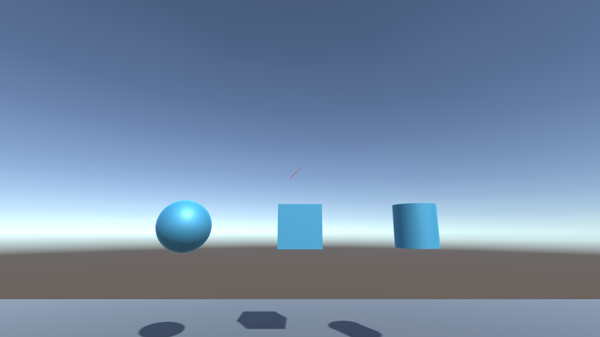
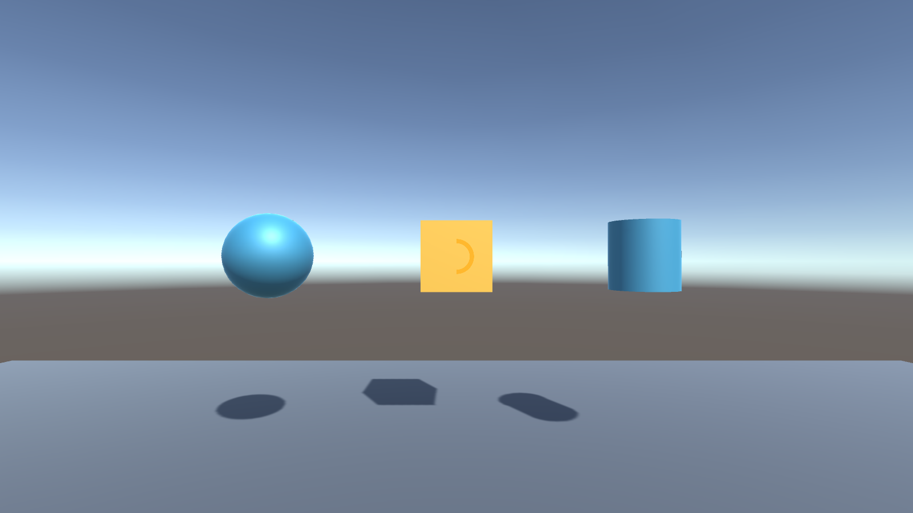
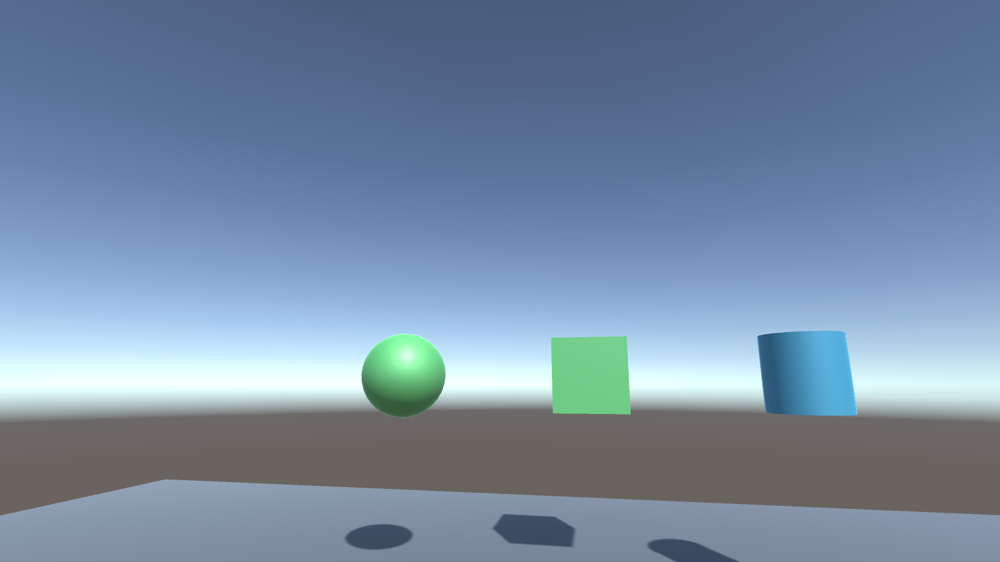

# Week 12 — Advanced XR: hands, gaze, and head-gaze dwell

**Chapter:** 8 — hand tracking, gaze, and multiplayer  
**Unity:** 2022.3.62f3  
**Scenes:**
- `Assets/Scenes/HandsAndGaze.unity` — the book's Chapter 8 scene: a hand-tracked XR Origin, a pinch-to-grab cube, and two gaze cubes (hover recolors one and shows a sphere; the other's label reads Hovered / Selected / Deselected). Wired with Inspector events only. Without a headset, the XR Device Simulator appears in Play mode; press **H** to switch it to hands.
- `Assets/Scenes/GazeDwell.unity` — the earlier custom head-gaze dwell prototype: look at a target for 1.2 seconds to toggle its selected state.

**Multiplayer:** the book uses Photon PUN 2, which needs an account and App ID, so it is not included here. The shared-room part of Chapter 8 is covered by [`Week-08-WebXR-WaterWorks`](../Week-08-WebXR-WaterWorks) (WebSocket relay, avatars, one holder per part).

## Hands and gaze scene

Rebuild it from the **Week 12** menu ([`Assets/Editor/BuildHandsAndGazeScene.cs`](Assets/Editor/BuildHandsAndGazeScene.cs)), in two steps because the imported samples must compile first:

1. **Week 12 → Import Hand Tracking Samples**: XRI Starter Assets, XR Device Simulator, Hands Interaction Demo, and the XR Hands HandVisualizer sample (already imported under `Assets/Samples`).
2. **Week 12 → Build Hands and Gaze Scene**: enables OpenXR with the Hand Interaction Profile and Hand Tracking Subsystem, then builds `HandsAndGaze.unity`.

## Packages

- Unity XR Interaction Toolkit **2.6.4**, XR Hands **1.4.3**, XR Plug-in Management **4.4.0**, and OpenXR **1.14.3** (pinned in `Packages/manifest.json`)
- Input System, installed as an XRI dependency (`com.unity.inputsystem`)
- For a headset: enable the OpenXR loader under XR Plug-in Management for your target platform and check Project Validation

For the gaze dwell scripts alone: create a **3D (Built-In Render Pipeline)** project in Unity 2022.3.62f3, add XRI through Package Manager, then copy `Assets/Scripts` into the project's `Assets` folder. XRI provides the XR Origin and camera; the gaze scripts use a physics ray from that camera and do not depend on a headset-specific gaze API.

## Ready-made project

This folder is also a Unity 2022.3.62f3 project with **Active Input Handling** set to **Input System Package (New)**. Open it in Unity Hub, then open `Assets/Scenes/HandsAndGaze.unity` or `Assets/Scenes/GazeDwell.unity`. The rest of this README describes the dwell scene: an XR Origin (VR) from XRI's menu, three gaze targets, and `GazeDwellInteractor` on the XR camera with a world-space progress ring 1 m ahead. It was generated by **Week 12 → Build Gaze Dwell Scene** ([`Assets/Editor/BuildGazeDwellScene.cs`](Assets/Editor/BuildGazeDwellScene.cs)). Without a headset, use the desktop fallback below. The ring in this scene stays centered because it is world-space; step 5 explains how to add an overlay ring that follows the cursor.

## Build the test scene

1. Add an **XR Origin (VR)** to a new scene using the XRI Starter Assets or the XRI XR Origin setup. Ensure its camera has a **Camera** component and the XR Origin is active. For a desktop-only test, a regular Camera also works.
2. Add a **Physics Raycaster** only if you use UI targets; the provided 3D targets use Unity physics raycasts directly.
3. Create a sphere or cube in front of the camera. Keep its collider enabled, add `GazeDwellTarget`, and leave its renderer assigned automatically or assign it in the Inspector.
4. Select the XR camera and add `GazeDwellInteractor`. Leave **Use Mouse Position** off for headset head-gaze. Set **Dwell Duration** to `1.2` seconds.
5. Optional progress ring: add a UI Image with **Image Type = Filled** and **Fill Method = Radial 360**, then assign it to **Dwell Indicator**. For a headset, put the ring on a World Space Canvas parented to the camera and position it in front of the view. For the mouse fallback, use a Screen Space - Overlay Canvas; the ring follows the cursor.
6. Press Play. Keep the target in the center of view until the dwell completes. It turns green; looking at it again toggles it back. The target's **On Dwell Complete** UnityEvent can trigger another scene action.

## Desktop fallback

No headset is needed. Enable **Use Mouse Position** on `GazeDwellInteractor`, then move the cursor over a target and hold it there for the dwell duration. The project must have the Input System package active; if Unity prompts for an input handling mode, select **Input System Package (New)** and restart the editor.

## Test checklist

- [ ] A target with a collider changes to its gaze color while aimed at.
- [ ] Leaving the target before 1.2 seconds clears the progress ring and does not select it.
- [ ] Holding gaze for 1.2 seconds selects the target and invokes its UnityEvent once.
- [ ] Looking away and dwelling again toggles the target back to its idle state.
- [ ] The mouse fallback can dwell on targets in the Game view without a connected headset.
- [ ] With a headset, the XR Origin camera drives gaze and the optional world-space progress ring is visible.

## Screenshots

Captured from a Windows build of `GazeDwell.unity` (Unity 2022.3.62f3, no headset). Head gaze was simulated by rotating the XR Origin so the camera's forward ray pointed at a target; `GazeDwellInteractor` itself was unchanged and used the camera ray, not the mouse.

*Idle, nothing gazed.*

*0.6 s into a dwell: gaze color and ring at 50%. Looking away at this point cleared the ring without selecting.*

*After 1.2 s dwells on the cube and sphere: both selected, and the cube's UnityEvent fired once. A second dwell on the cube toggled it back to idle.*

## Scripts

- `Assets/Scripts/GazeDwellInteractor.cs` — camera raycast, dwell timer, optional fill indicator, and editor mouse fallback.
- `Assets/Scripts/GazeDwellTarget.cs` — gaze/selection visual states and a configurable completion event.

This is a local interaction prototype only. No network transport, shared state, or remote avatars are implemented in this project; for the shared room, use the WaterWorks relay linked above.