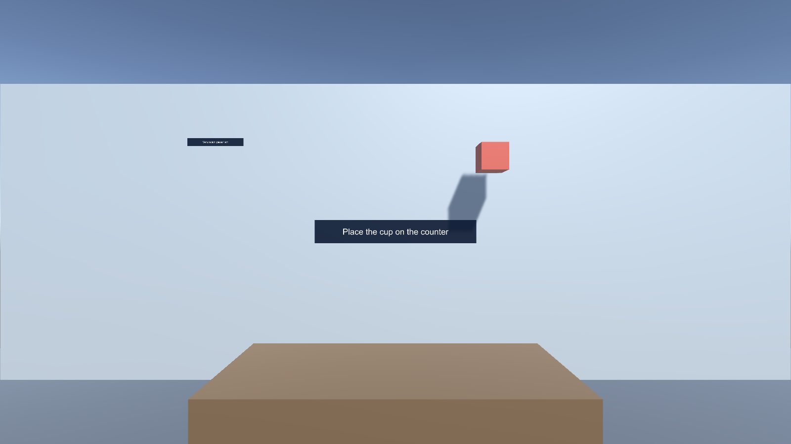
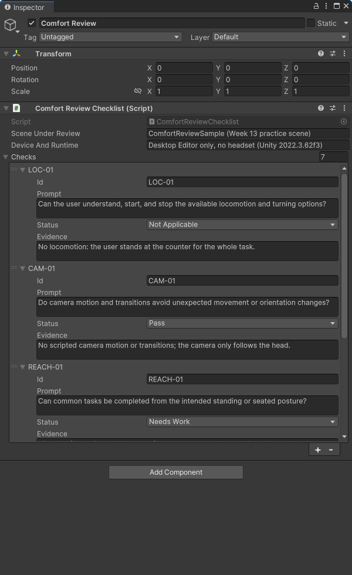
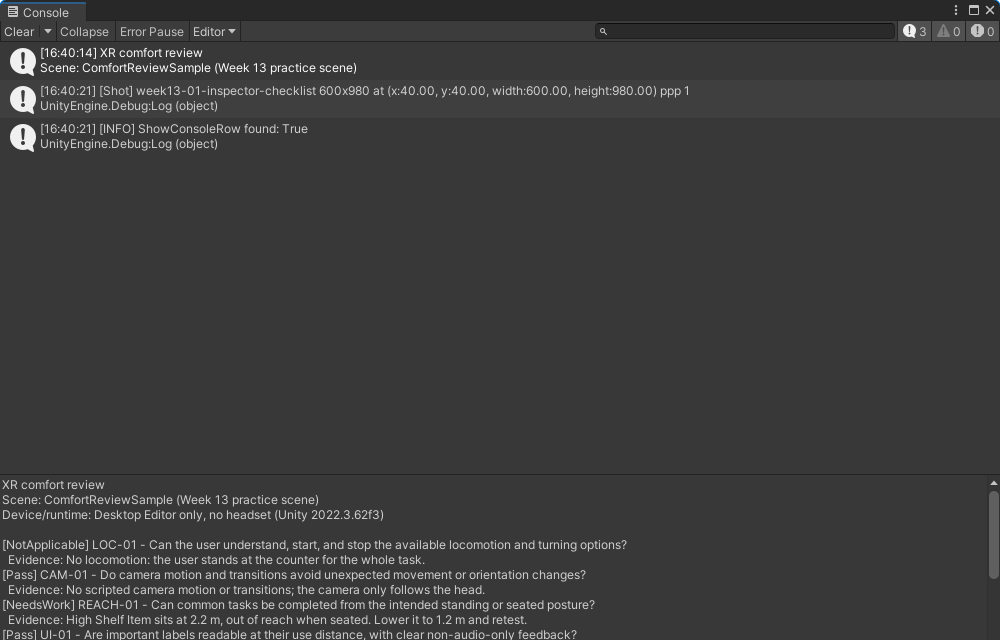

# Week 13 - XR best practices: comfort, validation, and review

> **Syllabus:** Chapter 9. Apply comfort and UX practices to a scene you already built, evaluate a toolkit against project needs, and review a teammate's change.

**Deliverable:** A revised scene, a completed comfort review with test evidence, a short toolkit/lifecycle decision, and a peer review recorded as a pull request or review document.

This is a source-first lab. It adds no XR package and makes no changes to your existing input, locomotion, or interaction setup. Use it with a scene from Weeks 4-12; the checklist works with SteamVR, OpenXR/XR Interaction Toolkit, or another stack.

## Practice project

This folder is also a Unity 2022.3.62f3 project. Open it in Unity Hub, then open `Assets/Scenes/ComfortReviewSample.unity`, select **Comfort Review**, and try the checklist before you review your own scene. The room has a few deliberate issues to find: a task label, a high shelf item, and an exit sign. The scene was generated by **Week 13 → Build Comfort Review Sample Scene** ([`Assets/Editor/BuildComfortReviewScene.cs`](Assets/Editor/BuildComfortReviewScene.cs)) and ships with every check set to **Not Run**.







*Captured in Unity 2022.3.62f3. For the Inspector and Console shots, example statuses and evidence were filled in (not saved to the scene), then **Print review report** was run. The report summarized Pass 2, Needs Work 2, Not Applicable 1, Not Run 2.*

## 1. Prepare a review copy

1. Use Unity **2022.3.62f3** and make a branch or copy of a prior XR project. Keep the original scene available for comparison.
2. Copy `Assets/Scripts/ComfortReviewChecklist.cs` from this example into that project's `Assets/Scripts/` folder. Open the project and resolve any compile errors before testing.
3. Choose one representative scene and write down its intended user, target device/runtime, and three common tasks. Record the current behavior before changing it.
4. In the scene, create an empty GameObject named `Comfort Review` and add **Comfort Review Checklist**. The component seeds starter checks when added; use its component menu's **Restore starter checks** command if needed.
5. Run the scene and test each task with the intended input and locomotion. Mark each check **Pass**, **Needs Work**, **Not Applicable**, or leave it **Not Run**. Add concise evidence or a reason for N/A in each check's Evidence field.
6. Select **Print review report** from the component menu. Save the Console output with your submission. The checklist records reviewer judgment; it does not certify comfort or replace testing with people and devices representative of the intended audience.

Stop a session if a tester feels unwell. Offer a seated break and do not ask anyone to continue through discomfort. A desktop test is useful for logic and layout, but it does not establish headset comfort.

## 2. Scene checks

Use the checklist as prompts, not universal pass/fail rules. Test the actual scene and record what happened, on which device, and what you changed.

| Area | Try this | Evidence to capture |
| --- | --- | --- |
| Locomotion | Exercise every movement and turning option the scene exposes. Confirm the user can understand and deliberately start/stop it; compare an available alternative when relevant. | Locomotion mode, input used, tester observation, and any setting changed |
| Camera and transitions | Trigger scene changes, scripted motion, teleports, and camera effects. Look for unexpected motion, abrupt orientation changes, or loss of user control. | Reproducible steps and the revised behavior |
| Reach and posture | Complete the common tasks from the intended standing and/or seated posture. Check frequent controls and objects, not just the easiest interaction. | Which tasks/postures were tried and what needed repositioning |
| UI and feedback | Read labels at the distance and angle where they are used. Check that important actions have understandable feedback and that sound is not the only essential cue. | Screenshot or short clip plus the change made |
| Access and recovery | Check the controls, pause/exit route, and any comfort/access options the project promises. Explain unsupported options rather than implying they exist. | Steps to find and use controls; reason for any N/A |
| Performance | Repeat representative tasks on the target setup under realistic scene load. Compare observations with the frame-time/performance target selected for that device and runtime; do not assume one universal target. | Device/runtime, settings, test duration, observed hitching, and measurement source |

For each finding, write it as **observation -> impact -> change -> retest**. For example: "The label was unreadable from the interaction point -> the user moved closer and lost the target -> moved the label and increased contrast -> repeated the task at the same point." Do not claim a fix improved comfort unless the retest supports that conclusion.

## 3. Lifecycle and toolkit decision

Write a short decision note for the scene you reviewed. Treat XR development as an iteration and support lifecycle, not only a successful Editor run:

1. **Define:** intended users, tasks, target devices/runtimes, constraints, and a testable comfort/performance goal.
2. **Prototype:** compare the riskiest interaction or locomotion choices early, before building the full scene around them.
3. **Build and validate:** test the scene in the Editor, then on the intended headset/runtime where available. Record device, build, settings, observations, and known limitations.
4. **Release and maintain:** identify who will check package/runtime compatibility, handle regressions, and revisit user feedback after a change.

Compare the toolkit(s) that could actually serve your target, such as the stack already in your project and one plausible alternative. Base the comparison on current primary documentation for the versions you evaluated; include the date and links or document titles. Do not infer device support, roadmap, or feature availability from a toolkit's name.

| Criterion | Questions for your decision |
| --- | --- |
| Target fit | Does the documented version support the device, runtime, deployment path, and input methods this project needs? |
| Interaction and comfort | Can the team implement and test the needed locomotion, interaction, accessibility, and recovery behavior? What would require custom work? |
| Lifecycle cost | What are the install, upgrade, migration, licensing, and team-learning costs? How will compatibility be checked? |
| Evidence and risk | Which claims came from version-matched primary documentation, which were tested, and what remains uncertain? |

Close with a recommendation, one trade-off, and one fact you would verify in a prototype. For an industry trend, cite a dated primary source and explain how it changes a project decision; avoid presenting predictions as settled facts.

## 4. Review / PR activity

Work in pairs. The author makes one focused change based on a recorded finding and opens a pull request (or shares a diff if hosted PRs are unavailable). The reviewer tests the stated steps, checks that the evidence supports the claim, and leaves at least one actionable comment or an explicit approval with rationale. The author records the response and retest. Keep the change small enough that the reviewer can understand its effect.

Use this review template in the PR description or a Markdown file:

```markdown
## Context
- Scene, intended user, device/runtime:
- Finding and reproduction steps:

## Change and validation
- Change made:
- Before/after evidence:
- Device, build, settings, and test steps:
- Result and known limitation:

## Toolkit / lifecycle decision
- Candidate(s), version(s), dated primary sources:
- Recommendation, trade-off, and next prototype check:

## Peer review
- Reviewer comment and author response:
- Retest result:
```

## 5. Rubric (100 points)

| Area | Points | Full-credit evidence |
| --- | ---: | --- |
| Scene validation | 30 | Relevant checks are run; report identifies the scene, setup, observations, and evidence; N/A and untested items are not presented as passes. |
| Revision and retest | 25 | At least one finding leads to a focused change, and the same task is retested with before/after evidence and limitations stated. |
| Lifecycle/toolkit decision | 20 | Recommendation fits stated users and targets, compares meaningful criteria, and cites dated, version-relevant primary sources. |
| Peer review | 25 | Review is specific and actionable, considers the reported test and regression risk, and includes an author response or justified approval plus retest. |

## 6. Testing steps and submission

- [ ] Unity 2022.3.62f3 imports the helper with no compiler errors.
- [ ] Add the component to a scene object; starter checks appear in the Inspector.
- [ ] Change statuses and evidence; **Print review report** reflects the edits and summarizes Pass, Needs Work, Not Applicable, and Not Run counts.
- [ ] Run the chosen scene's common tasks on the intended setup where available; label any desktop-only or unavailable-device checks honestly.
- [ ] Make one evidence-based scene revision and repeat the same test.
- [ ] Submit the review report, before/after evidence, toolkit/lifecycle note, and peer-review record with the revised project.

The project marker is `2022.3.62f3`. Copy only the helper into a prior project when doing the lab. This project adds no XR packages, and no generated Library, Temp, or build files are committed.